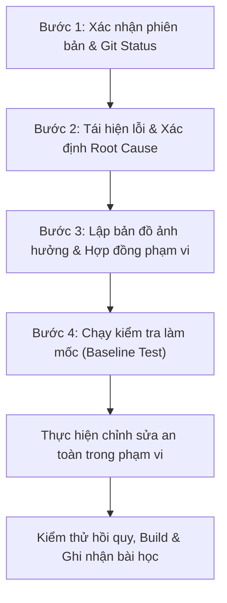

# H4CARE / PharmaTrust - Quy Chuẩn Kỹ Thuật, Quy Tắc An Toàn & Bộ Nhớ Lỗi (Safety Rules & Error Memory)

> **Tài liệu này được hệ thống tự động ghi nhớ và tuân thủ tuyệt đối cho mọi phiên làm việc tiếp theo của dự án H4CARE/PharmaTrust.**
> Mục tiêu tối thượng: Sửa đúng lỗi được giao, bảo vệ toàn vẹn các phần đang chạy tốt, tuân thủ nghiêm ngặt quy chuẩn an toàn và không tạo bất kỳ tác động tiêu cực nào ngoài phạm vi cho phép.

---

## 1. NGUYÊN TẮC AN TOÀN BẮT BUỘC KHI SỬA CODE (SAFE ENGINEERING RULES)

### 1.1. Chỉ sửa đúng phạm vi được giao
1. **Phạm vi tối thiểu**: Chỉ sửa các file thực sự cần thiết cho lỗi/yêu cầu hiện tại.
2. **Không sửa lan man**: Tuyệt đối không thay đổi giao diện, API, database hoặc nghiệp vụ không liên quan.
3. **Không đổi tên hàng loạt**: Không đổi tên file, class, biến, bảng hay endpoint nếu không có chỉ định bắt buộc.
4. **Không auto-format toàn bộ**: Không chạy công cụ format/linter trên toàn repository làm loãng `git diff`.
5. **Không tự ý nâng thư viện**: Không nâng cấp version dependencies trong `package.json` hoặc `requirements.txt` chỉ vì có phiên bản mới.
6. **Không tự ý refactor**: Không tái cấu trúc toàn bộ module trong một yêu cầu sửa lỗi nhỏ.
7. **Phát hiện lỗi phát sinh ngoài phạm vi**: Ghi nhận vào báo cáo để xin ý kiến người dùng, không tự tiện sửa khi chưa được phê duyệt.

### 1.2. Bảo vệ code và tính năng đang chạy tốt
1. **Chạy kiểm tra làm mốc**: Phải chạy test (`pytest`, `npm run build`) hoặc kiểm tra luồng hiện tại trước khi thay đổi để có kết quả đối chứng.
2. **Bảo tồn tương thích ngược**: Không thay đổi response payload của API hiện có nếu chưa kiểm tra tất cả các nơi đang tiêu thụ API đó. Cung cấp route alias hoặc trường tương thích song song khi cần.
3. **Không xóa code vội vàng**: Không xóa hàm, bảng hoặc cột cũ cho đến khi chắc chắn 100% không còn nơi nào sử dụng.
4. **Không che lỗi**: Tuyệt đối không dùng `try/except: pass` hoặc `catch(() => {})` để che giấu lỗi, trả mảng rỗng giả mạo hay báo thành công giả.
5. **Không sửa dữ liệu mẫu**: Không sửa đổi seed data, tài khoản mẫu hoặc cấu hình production chỉ để cho test vượt qua một cách giả tạo.

### 1.3. Tuyệt đối không đoán mò (No Guesswork)
Phải dừng lại và hỏi người dùng ngay lập tức nếu thiếu một trong các thông tin sau:
- Vai trò (Role) nào được phép thực hiện nghiệp vụ.
- Kho nào chịu trách nhiệm sở hữu đơn hàng hoặc tồn kho cụ thể.
- Công thức tính giá, chiết khấu, voucher, phí vận chuyển hoặc số tiền hoàn.
- Luồng chuyển trạng thái (State machine) trước và sau của đơn hàng / ca hoàn hàng.
- Quy chuẩn xử lý thuốc kê đơn (Rx), thuốc cận hạn (FEFO), thuốc bị thu hồi hoặc cách ly.
- Phương án xử lý và bảo toàn dữ liệu cũ khi thay đổi database schema.
- Thông tin định danh, credential hoặc môi trường sandbox của các dịch vụ bên ngoài (MoMo, PayOS, VNPay, VietQR, Maps, SMTP).
- Yêu cầu có được phép thay đổi giao diện đang chạy tốt hay phải giữ nguyên 100%.

### 1.4. Phân quyền Đa kho (RBAC) & Chống IDOR
- `ADMIN`: Toàn quyền xem và điều phối toàn hệ thống, toàn bộ kho. Không trực tiếp xử lý nghiệp vụ vận hành hàng ngày của kho con.
- `WAREHOUSE_MANAGER`: Chỉ thuộc 1 kho duy nhất (`warehouse_id`), chỉ xem và xử lý đơn hàng/nhân viên/lô thuốc thuộc đúng kho của mình. Nghiêm cấm can thiệp chéo kho.
- `WAREHOUSE_STAFF`: Chỉ thao tác trên các tác vụ lấy hàng, đóng gói, kiểm đếm hàng hoàn được phân công trong kho của mình. Không có quyền duyệt hoàn tiền hay chỉnh sửa tồn kho trực tiếp.
- `CUSTOMER` / `BUYER`: Khách hàng mua sắm storefront, chỉ xem đơn và thông tin của chính mình qua token JWT xác thực.
- **Backend là nơi quyết định quyền**: Mọi API bắt buộc kiểm tra phân quyền và `warehouse_id` tại backend; không bao giờ chỉ ẩn nút ở frontend. Mọi truy cập trái phép trả ngay HTTP `403 Forbidden`.

### 1.5. Bảo mật thông tin & Mật khẩu
- Tuyệt đối không lưu, truyền hoặc hiển thị mật khẩu dưới dạng văn bản thuần (plain text).
- Không bao giờ trả `password_hash`, secret key, token nhạy cảm, webhook secret về frontend hoặc in ra log.
- Mật khẩu tạm thời sau khi tạo/reset chỉ hiển thị **1 lần duy nhất** kèm nút copy an toàn.
- Bắt buộc đổi mật khẩu ở lần đăng nhập tiếp theo (`must_change_password = True`).
- Quản lý kho chỉ được quản lý và reset mật khẩu nhân viên thuộc kho của mình.

### 1.6. Quy tắc Backend & API
- Backend là nguồn thẩm quyền tối cao (Single Source of Truth) về giá cả, chiết khấu, tồn kho, trạng thái và số tiền hoàn.
- Không bao giờ tin tưởng các tham số nhạy cảm (`price`, `total_amount`, `refund_amount`, `warehouse_id`, `user_id`) do client gửi lên.
- Xác thực danh tính và phạm vi kho nghiêm ngặt từ JWT Access Token. Token hết hạn hoặc sai trả ngay `401 Unauthorized` (không âm thầm coi là khách vãng lai).
- Mọi thao tác tài chính, xuất/nhập kho, cập nhật trạng thái đơn phải có cơ chế **Idempotency** chống trùng lặp khi người dùng bấm liên tiếp.
- Mọi danh sách lớn phải có phân trang (`page`, `page_size`), lọc và sắp xếp tối ưu, tránh triệt để lỗi N+1 Query.

### 1.7. Quy tắc Frontend
- Giữ nguyên thiết kế và phong cách giao diện hiện tại trừ khi có yêu cầu thay đổi rõ ràng.
- Tuyệt đối không viết cứng `localhost`, URL cứng, ID sản phẩm hay ID kho vào component. Sử dụng cấu hình tập trung và API client chung (`api<T>()`).
- Hiển thị rõ ràng 4 trạng thái giao diện: `loading`, `success-empty`, `success-data`, và `error` (kèm thông điệp rõ và nút "Thử lại").
- Mọi nút bấm tạo giao dịch hoặc gửi dữ liệu phải có trạng thái loading và vô hiệu hóa chống click đúp (Double-click protection).
- Form nhập liệu phải giữ lại dữ liệu người dùng đã gõ nếu request gửi lên thất bại.

### 1.8. Quy tắc Database & Migration
- Không bao giờ can thiệp trực tiếp vào database production bằng các câu lệnh thủ công thiếu kiểm soát.
- Không sửa file migration đã được áp dụng; luôn tạo migration mới có thứ tự an toàn (`alembic revision --autogenerate`).
- Migration phải an toàn trên database đang có dữ liệu thật: trường mới phải có `default` hoặc `nullable=True`.
- Script chuyển đổi dữ liệu (Data backfill/migration) bắt buộc hỗ trợ cờ `--dry-run` trước khi cho phép `--commit`.
- Tuyệt đối không dùng lệnh xóa database (`DROP DATABASE`, xóa file sqlite) để giải quyết lỗi migration.
- Kiểm thử tự động phải chạy trên database test độc lập, không xâm phạm database chính.

### 1.9. Quy tắc Dược phẩm, Tồn kho & Đơn hàng
- Dữ liệu thuốc gốc (Master Data) do Admin quản lý; các chi nhánh kho chỉ quản lý tồn kho vật lý, số lô (Batch) và vị trí kho (Bin/Location).
- Không nhân bản (duplicate) sản phẩm cho từng kho; mọi biến thể quy đổi phải nối về `canonical_product_id`.
- Tồn kho luôn gắn liền với `(product_id, warehouse_id, batch_id)`.
- Tuyệt đối không cho phép sửa số lượng tồn kho tự do nếu không có chứng từ xuất/nhập/kiểm kê hợp lệ.
- Mọi biến động tồn kho bắt buộc phát sinh bản ghi `InventoryMovement` và `WarehouseAuditLog`.
- Tuân thủ nghiêm ngặt nguyên tắc **FEFO** (Hết hạn trước - Xuất trước). Lô thuốc cận hạn (< 180 ngày hoặc theo cấu hình) hoặc đang cách ly/thu hồi tuyệt đối không phân bổ cho đơn bán mới.
- Hàng đổi/trả phải được hoàn về đúng chi nhánh kho thực tế đã xuất hàng cho đơn đó.

### 1.10. Dịch vụ bên ngoài & Môi trường tích hợp
- Trong test tự động, tuyệt đối không gọi thật ra các dịch vụ ngoài (MoMo, PayOS, VNPay, VietQR, Google Maps, SMTP, Telegram). Luôn sử dụng Mock hoặc Sandbox.
- File `.env` chứa bí mật không bao giờ được commit lên Git. `.env.example` chỉ chứa tên biến và giá trị mẫu an toàn.
- Nếu nghi ngờ lộ key/credential, phải thông báo thu hồi và cấp mới ngay lập tức.
- Công cụ thu thập dữ liệu (Crawler) phải tuân thủ nghiêm ngặt `robots.txt`, giới hạn tần suất (Rate Limiting), không tấn công vượt rào trái phép.

### 1.11. Quy tắc Git & Phối hợp
- Luôn làm việc trên branch riêng (ví dụ `feature/multi-warehouse-rbac`, `fix/...`), tuyệt đối không commit trực tiếp lên `main`.
- Không bao giờ dùng `git reset --hard` hoặc các lệnh phá hủy làm mất các thay đổi chưa commit của người dùng.
- Kiểm tra kỹ `git diff` và `git status` trước khi commit. Không đưa file rác, file build (`dist/`), file `.env`, database backup, ảnh test vào Git.
- Commit message phải súc tích, phản ánh chính xác nghiệp vụ được xử lý.

### 1.12. Điều kiện bắt buộc phải dừng và xin ý kiến người dùng
Dừng lại ngay và tham vấn ý kiến trước khi tiếp tục nếu gặp các tình huống sau:
1. Phạm vi thực tế của vấn đề lớn hơn nhiều so với mô tả ban đầu.
2. Cần phải xóa bảng, cột, file hoặc dữ liệu đang tồn tại.
3. Cần thay đổi cấu trúc phân quyền hoặc luồng vận hành cốt lõi của hệ thống.
4. Phát hiện mâu thuẫn giữa code hiện tại và yêu cầu mới về quy tắc tài chính / y tế.
5. Cần credential thật của dịch vụ thanh toán/vận chuyển bên ngoài.
6. Phát hiện thay đổi chưa commit của người dùng trong các file cần sửa.

---

## 2. QUY TRÌNH 4 BƯỚC BẮT BUỘC TRƯỚC KHI SỬA CODE

Mỗi khi nhận nhiệm vụ sửa code, lập trình viên/AI phải tuân thủ trình tự:



### Bước 1: Xác nhận phiên bản
Ghi nhận: Branch hiện tại, commit gần nhất, kết quả `git status`, bảo toàn toàn bộ thay đổi chưa commit của người dùng.

### Bước 2: Tái hiện lỗi
Xác định chính xác các bước kích hoạt lỗi, mã lỗi HTTP, thông báo lỗi thực tế và kết quả mong đợi. Không dùng dữ liệu thật production để test.

### Bước 3: Lập bản đồ ảnh hưởng (Impact Mapping)
Liệt kê rõ trước khi code:
- Các file dự kiến sửa.
- API và Database schema liên quan.
- Giao diện người dùng tiêu thụ API.
- Các vai trò (Admin, Manager, Staff, Customer) bị tác động.
- Danh sách test cần chạy lại.

### Bước 4: Chạy kiểm tra làm mốc (Baseline)
Chạy bộ test hiện tại để ghi nhận các test đang pass/fail trước khi sửa. Không được quy kết một lỗi có sẵn từ trước là do lần sửa mới gây ra.

---

## 3. BỘ NHỚ CÁC LỖI ĐÃ XẢY RA VÀ BÀI HỌC (LESSONS LEARNED)

### 🔴 Lỗi 1: "Method Not Allowed" (405) / Lỗi kết nối khi cập nhật đơn hàng kho
- **Triệu chứng**: Bấm nút "Bàn giao" trên trang Đơn hàng kho (`/warehouse/orders`) báo lỗi `405 Method Not Allowed` hoặc "lỗi kết nối máy chủ".
- **Nguyên nhân**:
  1. Frontend gọi `PATCH /api/v1/warehouse-portal/orders/{id}/status`, nhưng router backend chỉ đăng ký `/fulfillment`.
  2. Tiến trình FastAPI chạy không có cờ `--reload`, code sửa xong nhưng chưa nạp vào RAM.
- **Quy tắc phòng ngừa**:
  1. Hỗ trợ cả 2 route alias: `@router.patch("/orders/{order_id}/status")` và `@router.patch("/orders/{order_id}/fulfillment")`.
  2. Hỗ trợ cả 2 tham số payload: `status` và `fulfillment_status`.
  3. Luôn khởi động server backend kèm cờ `--reload`.
  4. Kiểm tra `openapi.json` để xác minh route đã active trong bộ nhớ.

---

### 🔴 Lỗi 2: Lệch cổng và rò rỉ tiến trình trên Windows
- **Triệu chứng**: Gặp lỗi cổng bị chiếm dụng (8000, 5173, 3000) hoặc kết nối bị từ chối do tiến trình nền cũ còn giữ socket.
- **Nguyên nhân**: Quản lý task nền không dọn dẹp tiến trình cũ trước khi khởi động tiến trình mới.
- **Quy tắc phòng ngừa**:
  1. Kiểm tra và dừng tiến trình cũ đúng cách trước khi khởi chạy dịch vụ mới.
  2. Cổng chuẩn hóa: Backend `:8000`, Web Admin/Kho `:5173`, Storefront `:3000`.

---

### 🔴 Lỗi 3: Truy vấn chéo kho hoặc lộ thông tin kho khác (IDOR)
- **Triệu chứng**: Quản lý kho có thể thấy hoặc can thiệp dữ liệu của kho khác nếu thay đổi ID trên URL/request.
- **Nguyên nhân**: Thiếu bộ lọc `warehouse_id` hoặc thiếu kiểm tra quyền sở hữu trong các hàm update/delete.
- **Quy tắc phòng ngừa**:
  1. Mọi truy vấn của Quản lý kho bắt buộc phải gắn điều kiện lọc `warehouse_id = current_user.warehouse_id`.
  2. Tại mọi endpoint thao tác trên bản ghi cụ thể theo `id`, kiểm tra quyền sở hữu kho; nếu sai trả HTTP `403 Forbidden` ngay lập tức.

---

### 🔴 Lỗi 4: Lỗi nhật ký kho (Warehouse Audit Log) và Ghi nhận vết
- **Triệu chứng**: Lịch sử hoạt động kho bị trống hoặc thiếu phân loại hành động.
- **Nguyên nhân**: Thiếu gọi service ghi audit log khi thực hiện: nhập kho, kiểm kê, điều chỉnh tồn kho, đổi trạng thái đơn, đổi mật khẩu.
- **Quy tắc phòng ngừa**: Mọi thao tác can thiệp dữ liệu trong kho đều phải tạo bản ghi `WarehouseAuditLog` gồm: `user_id`, `warehouse_id`, `action`, `entity_name`, `entity_id`, `details`, `timestamp`.

---

### 🔴 Lỗi 5: Lỗi 500 khi bấm "Phiếu Soạn" (Pick Details) do sai tên thuộc tính Model ORM
- **Triệu chứng**: Bấm nút "Phiếu Soạn" trên trang Đơn hàng kho báo lỗi không có phản hồi hoặc crash modal.
- **Nguyên nhân**:
  1. Truy cập sai tên thuộc tính: `item.sku_id`, `item.unit_price` trên model `OrderItem` (thực tế là `item.product_id`, `item.product_sku`, `item.price`, `item.subtotal`).
  2. Truy cập `sku.unit_name` trên `ProductSku` (thực tế là `sku.uom`).
- **Quy tắc phòng ngừa**: Tuyệt đối không đoán tên thuộc tính ORM. Phải mở `entities.py` hoặc `inventory.py` tra cứu schema thực tế trước khi code.

---

### 🔴 Lỗi 6: Sai thuộc tính ORM trên CanonicalProduct và ProductIngredient
- **Triệu chứng**: Gặp lỗi `AttributeError: type object 'CanonicalProduct' has no attribute 'primary_image_url'` hoặc `'ProductIngredient' object has no attribute 'ingredient_name'`.
- **Nguyên nhân**: `CanonicalProduct` dùng `image_url`, `route`, `manufacturing_country`; `ProductIngredient` liên kết với `Ingredient` qua `ing.ingredient.normalized_name`.
- **Quy tắc phòng ngừa**: Kiểm tra chính xác model trong `entities.py`, dùng `getattr(ing, 'ingredient', None)` an toàn.

---

### 🔴 Lỗi 7: Đụng độ UNIQUE constraint khi sinh mã phiên nhập file
- **Triệu chứng**: Tải file kiểm thử trong cùng 1 giây báo lỗi `IntegrityError: UNIQUE constraint failed: warehouse_import_jobs.import_code`.
- **Nguyên nhân**: Mã sinh theo timestamp giây `%y%m%d%H%M%S` không có hậu tố ngẫu nhiên khi gọi đồng thời.
- **Quy tắc phòng ngừa**: Luôn gắn thêm hậu tố UUID ngắn (`f"-{uuid.uuid4().hex[:4].upper()}"`) vào mọi mã sinh tự động.

---

### 🔴 Lỗi 8: Lỗi lịch sử đơn hàng khách hàng rỗng và nuốt lỗi API
- **Triệu chứng**: Khách hàng đặt đơn thành công nhưng trang “Lịch sử đơn hàng” trả về danh sách rỗng.
- **Nguyên nhân**: Frontend gọi tra cứu theo số điện thoại qua URL cứng, khi bị chặn bảo mật (403) thì tự nuốt lỗi `.catch(() => setOrders([]))` làm người dùng tưởng chưa từng đặt đơn.
- **Quy tắc phòng ngừa**:
  1. Luôn xác thực qua JWT token bằng `GET /api/v1/store/orders/me` lọc `Order.user_id == current_user.id`.
  2. Frontend hiển thị rõ 4 trạng thái giao diện, tuyệt đối không nuốt lỗi mạng/401/500 thành mảng rỗng.

---

### 🔴 Lỗi 9: Xung đột vòng đời Leaflet Map khi unmount/zoom transition (`_leaflet_pos` is undefined)
- **Triệu chứng**: Vào trang giỏ hàng/thanh toán báo lỗi crash `Cannot read properties of undefined (reading '_leaflet_pos')`.
- **Nguyên nhân**: Leaflet chạy timer ngầm `_onZoomTransitionEnd` sau khi component đã unmount và `this._mapPane` đã bị xóa.
- **Quy tắc phòng ngừa**: Monkey-patch an toàn `_getMapPanePos` và `_onZoomTransitionEnd`, dọn dẹp timer và `map.stop()` trước khi `map.remove()`.

---

### 🔴 Lỗi 10: Lỗi 401 khi tải file nhập kho do lệch key token
- **Triệu chứng**: Quản lý kho bấm kiểm tra file báo khung cảnh báo đỏ "Bạn chưa đăng nhập".
- **Nguyên nhân**: Toàn hệ thống dùng key `pharmatrust_access_token`, nhưng trang nhập kho dùng hàm fetch riêng đọc sai key `access_token`.
- **Quy tắc phòng ngừa**: Luôn dùng hàm client tập trung `api<T>()`, bổ sung cơ chế đọc fallback hai chiều trong `tokenStore`.

---

### 🔴 Lỗi 11: Lỗi runtime ErrorBoundary `Cannot read properties of undefined (reading 'toLocaleString')`
- **Triệu chứng**: Giao diện React bị crash, bung màn hình ErrorBoundary: `"Đã xảy ra sự cố hiển thị - Trang vừa gặp lỗi hiển thị dữ liệu tạm thời..."` với lỗi `Cannot read properties of undefined (reading 'toLocaleString')`.
- **Nguyên nhân**: Gọi trực tiếp `.toLocaleString('vi-VN')` trên các trường số liệu từ API khi dữ liệu trả về `undefined` hoặc `null` (như `kpi.pending_refund_amount`, `rf.amount`, `it.unit_price`, `it.subtotal`, `selectedCase.refund_info.estimated_refund_amount`).
- **Quy tắc phòng ngừa**:
  1. Tuyệt đối không gọi `.toLocaleString()` trần. Luôn bọc giá trị mặc định bằng nullish coalescing: `(val ?? 0).toLocaleString('vi-VN')`.
  2. Tại Backend API, serialize đầy đủ các trường tính toán (`subtotal`, `unit_price`, `estimated_refund_amount`) và cung cấp alias tương thích (`refund_info` song song với `proposed_refund`).

---

### 🔴 Lỗi 12: TypeError "can't compare offset-naive and offset-aware datetimes" khi so sánh DateTime với SQLite
- **Triệu chứng**: Gặp lỗi `TypeError: can't compare offset-naive and offset-aware datetimes` khi so sánh `expires_at` lấy từ database với `datetime.now(UTC)` hoặc `utcnow()`.
- **Nguyên nhân**: SQLite không lưu native timezone của SQLAlchemy `DateTime(timezone=True)`. Khi nạp vào Python memory, đối tượng là offset-naive (`tzinfo=None`), gây crash khi so sánh trực tiếp với offset-aware datetime.
- **Quy tắc phòng ngừa**:
  1. Luôn sử dụng hàm chuyển đổi an toàn hai chiều:
     ```python
     def to_utc(dt: datetime | None) -> datetime | None:
         if dt is None:
             return None
         return dt.replace(tzinfo=UTC) if dt.tzinfo is None else dt.astimezone(UTC)
     ```
  2. Tuyệt đối không so sánh trực tiếp `model.datetime_col <= utcnow()` mà không bọc qua `to_utc()`.

---

### 🔴 Lỗi 13: AttributeError khi truy cập thông tin ngân hàng trên ReturnRequest (`'ReturnRequest' object has no attribute 'bank_name'`)
- **Triệu chứng**: Bấm nút "Xử lý ca" trên trang Ca hoàn kho (`/warehouse/returns`) báo alert pop-up: `"Không thể mở chi tiết ca hoàn: Đã xảy ra lỗi khi kết nối máy chủ"`.
- **Nguyên nhân**: Trong endpoint `get_manager_return_case_detail`, code truy cập trực tiếp `case.return_request.bank_name`, `case.return_request.bank_account_holder`, `case.return_request.bank_account_number`. Các trường này không thuộc model `ReturnRequest` mà thuộc model `Refund`. Khi ca hoàn mới tạo chưa có bản ghi `Refund`, API bị ném ngoại lệ 500 `AttributeError`.
- **Quy tắc phòng ngừa**:
  1. Lấy thông tin tài khoản thụ hưởng an toàn từ bản ghi `Refund` cuối cùng (nếu đã có): `getattr(last_refund, "beneficiary_bank", None) or "Mặc định"`.
  2. Bọc an toàn các số liệu tính toán bằng `or 0` hoặc fallback rõ ràng.
  3. Thêm test case hồi quy tự động trong pytest kiểm tra việc mở chi tiết ca hoàn mới.

---

### 🔴 Lỗi 14: Nút trạng thái đơn Admin hiển thị sai điều kiện và thông báo bị che
- **Triệu chứng**: Trong chi tiết đơn, bấm Xác nhận/Giao hàng/Hoàn thành/Hủy tưởng không có phản hồi hoặc thiếu quyền.
- **Nguyên nhân đã xác minh trên code**: API đã yêu cầu ADMIN đúng; giao diện bật cả thao tác không hợp lệ theo trạng thái/kiện hàng. Thông báo nằm ngoài modal nên bị lớp phủ che. Không thể kết luận tài khoản triển khai thực tế bị HTTP 403 nếu chưa có response/log.
- **Phòng ngừa**: Dùng chung policy backend cho validation và `status_actions` trong chi tiết đơn; hiển thị lý do khóa nút và kết quả ngay trong modal; sau thay đổi tải lại dữ liệu server. Không mở rộng role hoặc bỏ qua điều kiện xuất/giao hàng để chữa lỗi giao diện.
- **Kiểm thử**: ADMIN thực hiện bốn thao tác hợp lệ, role khác bị 403, khách chưa đăng nhập bị 401, metadata cũ không vượt qua validation mới nhất.

---

## 4. MA TRẬN ĐÁNH GIÁ ẢNH HƯỞNG & ĐỊNH NGHĨA HOÀN THÀNH

### 4.1. Ma trận 17 khu vực nghiệp vụ cần rà soát sau mỗi thay đổi

| STT | Khu Vực Nghiệp Vụ | Có Ảnh Hưởng? | Kiểm Tra Đã Chạy | Trạng Thái |
|:---:|---|:---:|---|:---:|
| 1 | Đăng nhập, Token JWT & Đổi mật khẩu | [ ] | Kiểm tra auth flow, token expire | Đạt / Bỏ qua |
| 2 | Phân quyền Admin Tổng | [ ] | Xem đơn toàn hệ thống, audit log | Đạt / Bỏ qua |
| 3 | Phân quyền Quản lý kho (Manager) | [ ] | Chỉ xem kho mình, chống IDOR | Đạt / Bỏ qua |
| 4 | Phân quyền Nhân viên kho (Staff) | [ ] | Lấy hàng, đóng gói, kiểm hàng hoàn | Đạt / Bỏ qua |
| 5 | Giao diện Storefront khách hàng | [ ] | Xem giỏ hàng, đặt hàng, lịch sử đơn | Đạt / Bỏ qua |
| 6 | Danh mục thuốc & SKU gốc | [ ] | Dữ liệu gốc Admin, tra cứu | Đạt / Bỏ qua |
| 7 | Tồn kho & Vị trí kho | [ ] | Số lượng khả dụng, on-hand | Đạt / Bỏ qua |
| 8 | Lô thuốc, HSD & Nguyên tắc FEFO | [ ] | Ưu tiên lô cận hạn, chặn lô hết hạn | Đạt / Bỏ qua |
| 9 | Nhập hàng & Import file Excel/CSV | [ ] | Preview, commit, idempotency mã | Đạt / Bỏ qua |
| 10 | Điều chuyển hàng giữa các chi nhánh | [ ] | Xuất kho nguồn, nhập kho đích | Đạt / Bỏ qua |
| 11 | Đơn hàng & Kiện hàng (Fulfillment) | [ ] | Phân tách đơn 1-nhiều kho | Đạt / Bỏ qua |
| 12 | Thanh toán (MoMo, COD, Chuyển khoản) | [ ] | Mock sandbox, trạng thái giao dịch | Đạt / Bỏ qua |
| 13 | Đổi hàng & Giao thay thế | [ ] | Tính chênh lệch giá, đơn đổi | Đạt / Bỏ qua |
| 14 | Trả hàng & Biên bản kiểm đếm kho | [ ] | Phân tách ca hoàn về đúng kho xuất | Đạt / Bỏ qua |
| 15 | Hoàn tiền (Refund) | [ ] | Backend tính số tiền, mật khẩu duyệt | Đạt / Bỏ qua |
| 16 | Nhật ký kiểm toán (Audit Log) | [ ] | Ghi nhận actor, entity, thay đổi | Đạt / Bỏ qua |
| 17 | Database Migration & Backfill | [ ] | Alembic migration, an toàn dữ liệu | Đạt / Bỏ qua |

### 4.2. Định nghĩa hoàn thành nhiệm vụ (Definition of Done - DoD)
Một nhiệm vụ sửa code chỉ được nghiệm thu và công bố hoàn thành khi thỏa mãn đầy đủ 10 tiêu chí:
1. Đã tìm ra và giải quyết tận gốc nguyên nhân (Root Cause), không vá tạm phần ngọn.
2. Code sửa nằm đúng trong phạm vi cho phép; không làm thay đổi các module đang chạy tốt.
3. Toàn bộ backend tests liên quan chạy qua 100% (`pytest` 0 lỗi).
4. Frontend build thành công 100% (`cmd /c "npm run build"` với 0 lỗi TypeScript).
5. Phân quyền và bảo mật IDOR được kiểm tra nghiêm ngặt tại Backend.
6. Không làm mất mát, sai lệch dữ liệu cũ; migration an toàn có khả năng rollback.
7. Không nuốt lỗi mạng, không che giấu lỗi bằng `except: pass` hoặc mảng rỗng.
8. Mọi số liệu hiển thị tiền/số lượng đều được phòng thủ bằng `(val ?? 0).toLocaleString('vi-VN')`.
9. `git diff` sạch sẽ, không chứa file rác, file `.env`, file build hay format ngoài lề.
10. Đã cập nhật bài học và quy tắc phòng ngừa vào `GEMINI.md` nếu phát hiện lỗi mới.
